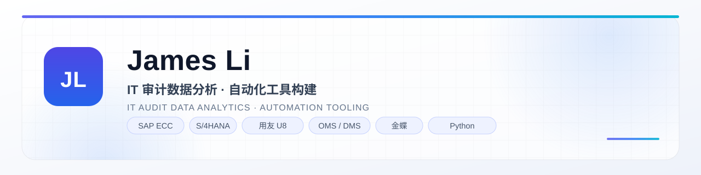

<!-- 主题自适应横幅：浅色 / 深色自动切换 -->
<picture>
  <source media="(prefers-color-scheme: dark)" srcset="./assets/banner-dark.svg">
  
</picture>

### IT 审计数据分析 · 自动化工具构建
IT AUDIT DATA ANALYTICS · AUTOMATION TOOLING

 

 

从 **SAP ECC / S/4HANA、用友 U8、OMS / DMS、金蝶** 等多源系统取数，构建**采购 / 销售三单匹配**、业财核对与 **JE Testing** 的自动化流程，输出可复核、可追溯的差异分析结果。
*Building reconciliation pipelines across SAP, Yonyou U8, OMS / DMS and Kingdee — three-way matching, business-finance reconciliation and JE testing — delivering reviewable, traceable variance analysis.*

  

        

 

<a href="#-动态"><b>📊 动态</b></a> &nbsp;·&nbsp; <a href="#-个人笔记"><b>📓 个人笔记</b></a> &nbsp;·&nbsp; <a href="#-核心工具"><b>🧰 核心工具</b></a> &nbsp;·&nbsp; <a href="#-核心方法论"><b>🧠 方法论</b></a> &nbsp;·&nbsp; <a href="#-参考与官方文档"><b>📚 参考</b></a> &nbsp;·&nbsp; <a href="#compliance"><b>🛡️ 合规</b></a> &nbsp;·&nbsp; <a href="#-english"><b>🌐 English</b></a>

---

## 🧑‍💻 关于我

| | |
|---|---|
| **🏢 背景** | 四大 IT 审计（DTT ×2 年、KPMG ×2 年），现专注审计数据分析与自动化工具建设 *Big-4 IT audit background (2 yrs DTT, 2 yrs KPMG), now focused on audit data analytics and automation tooling.* |
| **🔧 做法** | 把审计逻辑沉淀为**可复用的数据工具**——三单匹配、SAP 取数、多源对账、CAATS / JE Testing *Turning audit logic into reusable tools: matching, extraction, reconciliation, CAATS / JE testing.* |
| **✅ 纪律** | **可复核优先**：每个结论都附带口径说明、源数据逻辑与运行记录，支撑审计留痕 *Reviewability first: every result ships with its basis, source-data logic and run records.* |

---

## 📊 动态

---

## 📓 个人笔记

> **[gvmeakiss-notebook](https://github.com/Gvmeakiss/gvmeakiss-notebook)** —— 通用配置、工具说明与 AI Skill 的收纳本。五个独立项目各自成篇，从目录里的 `README.md` 进入。

| 项目 | 说明 |
|---|---|
| ✂️ **[screenshot-text-edit](https://github.com/Gvmeakiss/gvmeakiss-notebook/tree/main/skills/screenshot-text-edit)** AI Skill | **截图文字 / 数字高保真修改** —— 字形克隆法，保真度远高于字体重绘；含 CLI 脚本与 macOS Vision OCR |
| 🪟 **[win-ai-gaming-setup](https://github.com/Gvmeakiss/gvmeakiss-notebook/tree/main/skills/win-ai-gaming-setup)** AI Skill | **新装 Windows 一条命令配成「AI 开发 + 游戏」机** —— 七阶段 `check → dev → apps → drivers → tune → link → verify`，先快照、可按基线回滚 |
| 📐 **[mini-app-spec](https://github.com/Gvmeakiss/gvmeakiss-notebook/tree/main/mini-app-spec)** 技术规范 | **企业级「AI Agent 驱动轻应用平台」技术规范** —— 静态导出 + BFF 中介 + SQL 预定义 + 原子替换部署 |
| 📊 **[audit-kanban](https://github.com/Gvmeakiss/gvmeakiss-notebook/tree/main/audit-kanban)** 演示应用 | **离线稽核工作进度看板** —— 同事填报 → 专人汇总 → 经理看板；纯前端双击即用，含虚构演示数据 |
| 📡 **[shadowrocket](https://github.com/Gvmeakiss/gvmeakiss-notebook/tree/main/shadowrocket)** 配置 | **通用分流配置** —— 国内外分流 / 去广告 / 长连接优化，Mac 与 iPhone 共用 |

---

## 🧰 核心工具

> 按日常工作的链路组织：**取数 → 匹配 → 复核 → 沉淀为 Skill**。每个仓库都能独立运行，说明与参数见各自 `README.md`。

### 📥 取数与 JE 核对

| 工具 | 解决的问题 | 关键能力 |
|---|---|---|
| 📒 **[sap-abap-data-extraction](https://github.com/Gvmeakiss/sap-abap-data-extraction)** | SAP 里该取哪些表、字段怎么对上审计科目 | KAAP 取数配置与操作手册，覆盖 **FI / MM / SD**；每模块给出取数范围与审计场景映射（序时账 BKPF + BSEG、余额 FAGLFLEXT / GLT0、订单 / 收货 / 发票、凭证流 VBFA） |
| 🧾 **[sap-je-toolkit](https://github.com/Gvmeakiss/sap-je-toolkit)** | 多公司序时账合并后，余额到底对不对 | 序时账合并 + **期初 / 发生额 / 期末余额勾稽** + 交叉验证，定位不平的公司与科目 |

### 🛒💰 三单匹配与对账

| 工具 | 解决的问题 | 关键能力 |
|---|---|---|
| ⚙️ **[purchase-three-match-configurable](https://github.com/Gvmeakiss/purchase-three-match-configurable)** | 每个项目都重写一遍匹配脚本 | 配置驱动的通用匹配引擎：SQL 解析 / 缓存 / 匹配键 / 差异分类 / Excel 导出 |
| 🧮 **[sales-oms-dms-match](https://github.com/Gvmeakiss/sales-oms-dms-match)** | OMS / DMS 与 SAP 三方销售数据对不上 | 双源销售三单匹配，输出 **5 类差异**，按销售组织分组导出 |
| 📊 **[u8-inventory-valuation](https://github.com/Gvmeakiss/u8-inventory-valuation)** | U8 存货发出计价是否算对 | 审计复核双工作簿（CAATS / ITA 职责分离） |

### 📦 可复用 Skill

| Skill | 解决的问题 | 关键能力 |
|---|---|---|
| 🧩 **[kpmg-da-skills](https://github.com/Gvmeakiss/kpmg-da-skills)** | 审计数据分析流程难以复现 | **8 个**可移植的审计数据分析技能：workbench 路由、DA routine 底稿生成、配套模板 |

<b>▸ 其余公开仓库去哪儿找</b>

 

完整清单见 **[github.com/Gvmeakiss?tab=repositories](https://github.com/Gvmeakiss?tab=repositories)**。上面列的是日常最常用的入口；客户专属落地版（采购 / 销售三单匹配的分年度、分渠道实现）与通用工具集（CAATS SQL 模板、模拟数据生成、Excel 合并等）都在仓库列表里，按主题命名，需要时可直接检索。

---

## 🧠 核心方法论

| 方法论 | 说明 |
|---|---|
| **三单匹配** Three-Way Matching | 采购订单 / 收货单 / 发票三方核对，定位差异并按类归因 |
| **多源数据对账** Multi-source Reconciliation | OMS / DMS / SAP 等系统间数据一致性校验，差异可下钻到单据 |
| **可复核输出** Reviewable Output | 每个结论附带口径说明、源数据逻辑与运行记录，支撑审计留痕 |

---

## 📚 参考与官方文档

> 三单匹配 / 序时账-余额核对 / 多源对账的逻辑依赖各 ERP 的标准数据结构与接口规范，以下为厂商官方文档，作为数据口径与字段映射的权威依据。

| 系统 | 文档 |
|---|---|
| 🟦 **SAP** ECC / S/4HANA | [SAP Help Portal](https://help.sap.com/docs/) — 官方帮助门户，覆盖 ECC / S/4HANA 全模块 [SAP ERP (ECC) 文档](https://help.sap.com/docs/SAP_ERP) — MM / SD / FI 标准配置与底表结构 [SAP S/4HANA 文档](https://help.sap.com/docs/SAP_S4HANA_ON_PREMISE) — 总账（ACDOCA）与凭证架构 [ABAP 关键字 / 数据字典](https://help.sap.com/doc/abapdocu_latest_index_htm/latest/index.htm) — 标准底表（BKPF / BSEG / EKPO / VBAK …）字段与域定义 |
| 🟥 **用友 U8** | [用友开发者中心](https://developer.yonyou.com/) — U8 / U9 / NC 开放接口与开发文档 [用友 U8 产品与文档](https://u8.yonyou.com/) — U8 存货 / 供应链 / 财务模块说明 |
| 🟩 **金蝶** Kingdee | [金蝶开放平台](https://open.kingdee.com/) — 金蝶云·苍穹 / K/3 开放 API 与集成规范 [金蝶开发者社区](https://dev.kingdee.com/) — 苍穹 PaaS 开发文档与数据模型 [金蝶官网](https://www.kingdee.com/) — 产品与模块总览 |

---

## 🛡️ 数据合规

> 本主页仅用于技术交流，分享**无收益分成**的通用代码处理逻辑，全部内容已脱敏。
> 依据 **PIPL 第 51 / 73 条**（去标识化 / 匿名化）、**数据安全法第 21 / 27 条**（分类分级保护）、**反不正当竞争法第 9 条**（商业秘密保护）处理。
> 脱敏范围：客户名称、法律实体、内部标识 / 代号、真实地址、支付与账户信息、订单 / 商品编码、财务数据及任何客户底稿。
> **任何财务数据与客户工作底稿均不在本主页及其仓库中存储或上传。**

---

## 🇬🇧 English

<b>Click to expand · 点击展开英文版</b>

 

### About

- **Background** — Big-4 IT audit (2 yrs DTT, 2 yrs KPMG); now focused on audit data analytics and automation tooling
- **Approach** — Turning audit logic into reusable data tools: three-way matching, SAP extraction, multi-source reconciliation, CAATS / JE testing
- **Discipline** — Reviewability first: every result ships with its basis, source-data logic and run records for the audit trail

### Notebook

> **[gvmeakiss-notebook](https://github.com/Gvmeakiss/gvmeakiss-notebook)** — five standalone projects: reusable configurations, tooling notes and AI skills. Each has its own `README.md`.

| Project | Description |
|---|---|
| ✂️ **[screenshot-text-edit](https://github.com/Gvmeakiss/gvmeakiss-notebook/tree/main/skills/screenshot-text-edit)** AI Skill | **High-fidelity text/digit editing inside screenshots** — glyph-cloning method, far more faithful than font redraw; CLI scripts + macOS Vision OCR |
| 🪟 **[win-ai-gaming-setup](https://github.com/Gvmeakiss/gvmeakiss-notebook/tree/main/skills/win-ai-gaming-setup)** AI Skill | **One command turns a fresh Windows box into an AI-development + gaming machine** — seven phases `check → dev → apps → drivers → tune → link → verify`; snapshot first, roll back from the baseline |
| 📐 **[mini-app-spec](https://github.com/Gvmeakiss/gvmeakiss-notebook/tree/main/mini-app-spec)** Tech spec | **Enterprise "AI-Agent-driven light-app platform" technical spec** — static export + BFF mediation + predefined SQL + atomic-swap deployment |
| 📊 **[audit-kanban](https://github.com/Gvmeakiss/gvmeakiss-notebook/tree/main/audit-kanban)** Demo app | **Offline audit work-progress kanban** — member updates → consolidator merge → manager board; pure front-end, double-click to run, fabricated demo data |
| 📡 **[shadowrocket](https://github.com/Gvmeakiss/gvmeakiss-notebook/tree/main/shadowrocket)** Config | **General-purpose routing rules** — CN / global split, ad-block, long-connection tuning; shared by Mac and iPhone |

### Core tools

> Organised along the working chain: **extract → match → review → distill into skills**. Each repo runs standalone; see its `README.md`.

#### 📥 Extraction & JE testing

| Tool | Problem it solves | Key capabilities |
|---|---|---|
| 📒 **[sap-abap-data-extraction](https://github.com/Gvmeakiss/sap-abap-data-extraction)** | Which SAP tables to pull, and how fields map to audit assertions | KAAP extraction config & runbook for **FI / MM / SD**, with scoping and audit-scenario mapping (journals BKPF + BSEG, balances FAGLFLEXT / GLT0, orders / receipts / invoices, document flow VBFA) |
| 🧾 **[sap-je-toolkit](https://github.com/Gvmeakiss/sap-je-toolkit)** | After merging multi-company journals, do the balances tie out | Journal consolidation + **opening / activity / closing balance check** + cross-validation, pinpointing the company and account that breaks |

#### 🛒💰 Matching & reconciliation

| Tool | Problem it solves | Key capabilities |
|---|---|---|
| ⚙️ **[purchase-three-match-configurable](https://github.com/Gvmeakiss/purchase-three-match-configurable)** | Rewriting the matching script for every engagement | Configurable generic engine: SQL parsing / caching / match keys / variance classification / Excel export |
| 🧮 **[sales-oms-dms-match](https://github.com/Gvmeakiss/sales-oms-dms-match)** | OMS / DMS and SAP sales data not agreeing | Dual-source sales three-way match, **5 variance classes**, grouped export by sales organisation |
| 📊 **[u8-inventory-valuation](https://github.com/Gvmeakiss/u8-inventory-valuation)** | Whether U8 inventory issue valuation is computed correctly | Dual audit-review workbooks (CAATS / ITA segregation of duties) |

#### 📦 Reusable skills

| Skill | Problem it solves | Key capabilities |
|---|---|---|
| 🧩 **[kpmg-da-skills](https://github.com/Gvmeakiss/kpmg-da-skills)** | Audit data-analytics routines that are hard to reproduce | **8** portable audit data-analytics skills: workbench routing, DA-routine workpaper generation, bundled templates |

### Methodology

| Methodology | Description |
|---|---|
| **Three-Way Matching** | Cross-check purchase order / goods receipt / invoice; locate and classify variances |
| **Multi-source Reconciliation** | Consistency checks across OMS / DMS / SAP, drillable to document level |
| **Reviewable Output** | Every result ships with its basis, source-data logic and run records |

### Compliance

> For technical exchange only, on a **no-revenue-sharing** basis; fully desensitized under **PIPL (Art. 51 / 73)**, the **Data Security Law (Art. 21 / 27)** and the **Anti-Unfair-Competition Law (Art. 9)**. Scope: client names, legal entities, internal codes, real addresses, payment/account info, order/product codes, financial data and any client workpapers. **No financial data or client workpapers are stored or uploaded here.**

### References

| System | Docs |
|---|---|
| 🟦 **SAP** ECC / S/4HANA | [SAP Help Portal](https://help.sap.com/docs/) — all ECC / S/4HANA modules [SAP ERP (ECC) Docs](https://help.sap.com/docs/SAP_ERP) — MM / SD / FI standard config and tables [SAP S/4HANA Docs](https://help.sap.com/docs/SAP_S4HANA_ON_PREMISE) — general ledger (ACDOCA) and document architecture [ABAP Keyword / Data Dictionary](https://help.sap.com/doc/abapdocu_latest_index_htm/latest/index.htm) — fields and domains of standard tables |
| 🟥 **Yonyou U8** | [Yonyou Developer Center](https://developer.yonyou.com/) — open APIs and dev docs for U8 / U9 / NC [Yonyou U8 Product & Docs](https://u8.yonyou.com/) — inventory / supply chain / finance modules |
| 🟩 **Kingdee** | [Kingdee Open Platform](https://open.kingdee.com/) — Kingdee Cloud·Cosmic / K/3 open APIs [Kingdee Developer Community](https://dev.kingdee.com/) — Cosmic PaaS docs and data models [Kingdee Official Site](https://www.kingdee.com/) — product overview |

---

<a href="#top"><code>⬆ 回到顶部 · Back to top</code></a>

  

*Personal projects and personal views. Not affiliated with or endorsed by any former employer (DTT / KPMG) or client.* 
*本页内容为个人项目与个人观点，与任何前雇主（DTT / KPMG）及客户无关。*

